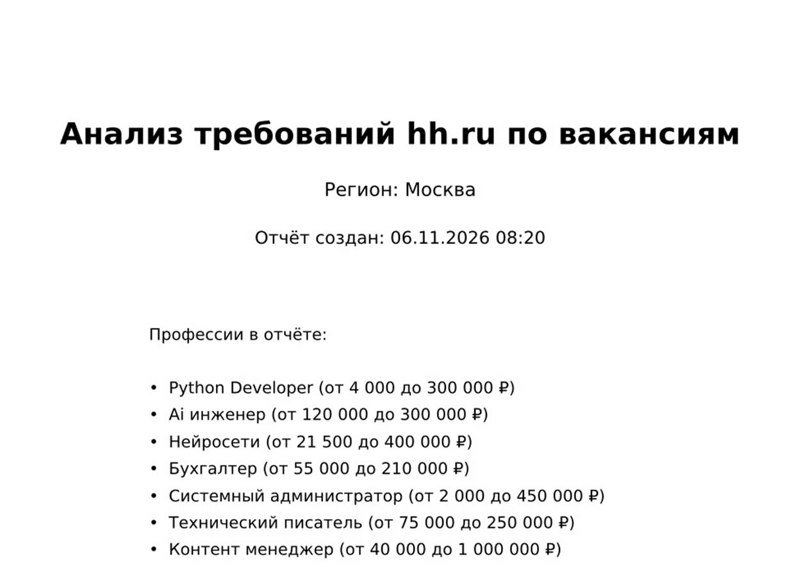
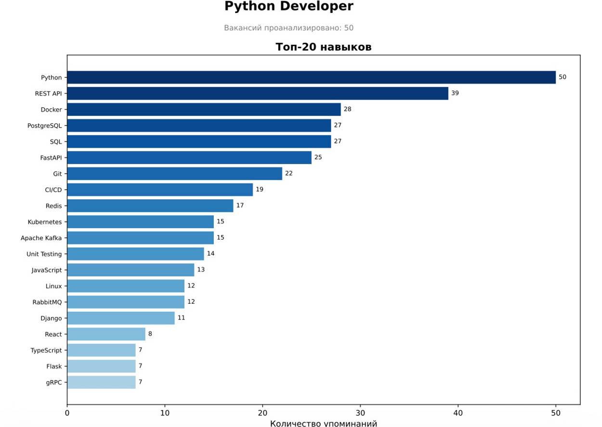
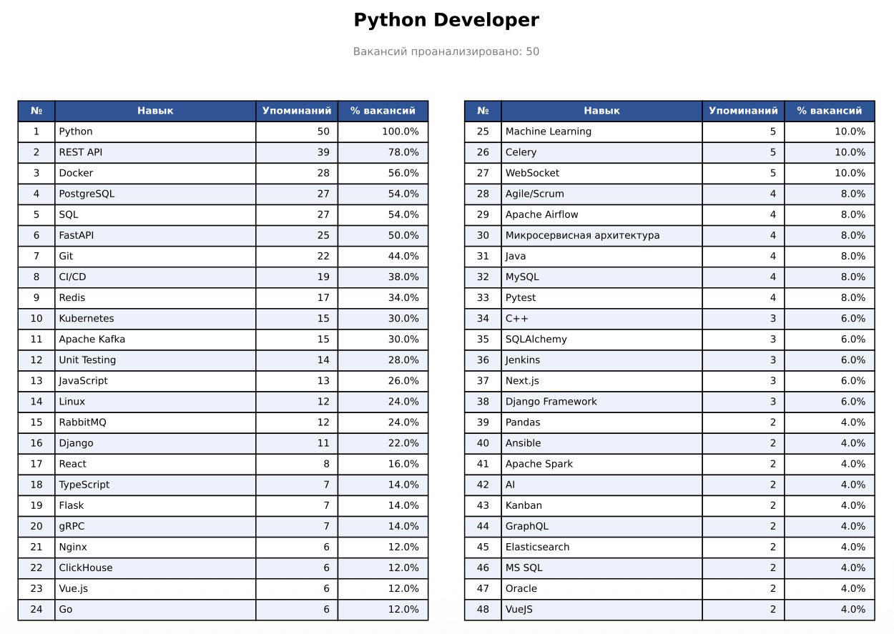
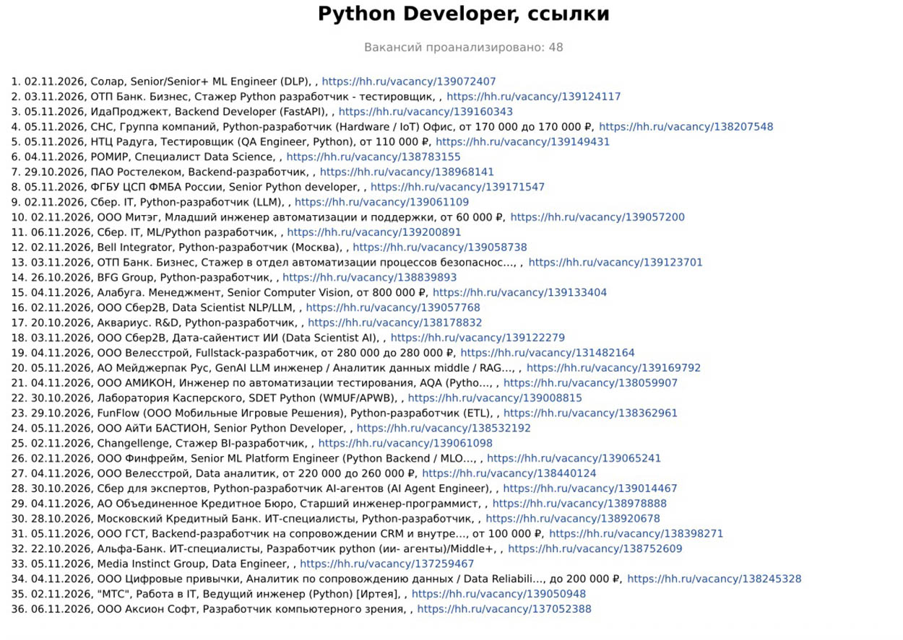
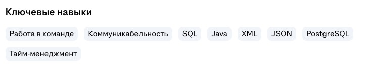

# 🕷️ HH Skills Parser

A Python system for parsing skills and vacancies from hh.ru. It automatically collects vacancies via Selenium, extracts key skills, and builds tabular reports sorted by mention frequency.

The code was written with the help of an LLM (Large Language Model).


Russian version: [README_RU.md](README_RU.md)

## 🖼️ Report Page Examples

<div align="center">

&nbsp; &nbsp;

</div>
<div align="center">

&nbsp; &nbsp;

</div>

## 🏗️ Architecture

### System Components

1. **config.py** — Configuration + skills dictionary
   - Dictionaries from dictionary/ for skill extraction
   - Parser settings via dataclass
   - YAML load/save

2. **hh_core.py** — Core (data and collection):
   - **Vacancy** — vacancy model
   - **HHSeleniumScraper** — hh.ru parser via Selenium
   - **SkillExtractor** — NLP skill extraction
   - **Storage** — data storage (SQLAlchemy)
   - vacancy page fetching and parsing of employer/date/salary

3. **hh_reports.py** — Report generators:
   - **ReportGenerator** — Excel, CSV, PNG chart
   - **PdfReportGenerator** — multi-page PDF with clickable links

4. **hh_pipeline.py** — Workflows:
   - **run_parsing** — full parsing run
   - **recalc_skills** — skill recalculation over the DB
   - **fill_employers** — backfilling employers/dates
   - **report_only** / **build_sections_from_db** — reports from the DB

5. **main.py** — CLI entry point (arguments, logging, mode dispatch)

### Data Flow

```
Professions input → Selenium parser → Raw data → Skill extraction →
vacancies.db → Report generators → reports/
```

### Project Structure

```
python_project/
├── main.py                  # Entry point (CLI, logging)
├── hh_core.py               # Vacancy model, Selenium scraper, skill extraction, storage
├── hh_reports.py            # Report generators: Excel/CSV/PNG and PDF
├── hh_pipeline.py           # Workflows: parsing, recalculation, backfill, DB reports
├── config.py                # Parser configuration
├── dictionary/              # Skill dictionaries (.yaml) and collection config config.yaml
├── vacancies.db             # SQLite database (created automatically)
├── requirements.txt         # Python dependencies
├── reports/                 # Output reports
│   ├── skills_report.xlsx   # Excel table
│   ├── skills_report.csv    # CSV table
│   ├── skills_chart.png     # Top-20 skills chart
│   └── YYYY-MM-DD-hh-parser.pdf  # PDF: title page (region, salary ranges); per profession — chart, skills table, and vacancy list (comma-separated lines with links)
├── log/                     # Logs: one file per month (2026-11-hh-parser.log)
├── tests/
│   └── test_all.py          # Combined tests
├── README.md                # This file (English)
└── README_RU.md             # Russian version
```

## 🚀 Quick Start

### 1. Install Dependencies

```bash
pip install -r requirements.txt
```

### 2. Install Chrome Browser

**Windows:** Download from <https://www.google.com/chrome/>

**macOS:**

```bash
brew install --cask google-chrome
```

**Linux (Ubuntu/Debian):**

```bash
sudo apt-get install google-chrome-stable
```

### 3. Run the Parser

```bash
python main.py
```

Without `--config`, `dictionary/config.yaml` is picked up automatically —
the config with professions and dictionaries.

Or with parameters:

```bash
python main.py -p "Python Developer" "Data Engineer" --pages 10
```

## 📋 Usage

### Command-Line Parameters

```bash
# Specify professions
python main.py -p "Python Developer" "Data Engineer" "Backend Developer"

# Specify region (1=Moscow, 2=Saint Petersburg)
python main.py -a 2

# Specify number of pages
python main.py --pages 10

# Combined command
python main.py -p "Go Developer" -a 1 --pages 15

# Quick run: fewer pages and a details limit
python main.py -p "Python Developer" --pages 2 --max-details 40

# Recalculate skills over the whole DB with new dictionaries (adds, never deletes);
# skills_*.yaml expands to all seven dictionaries — or list only the ones you need
python main.py --recalc-skills dictionary/skills_*.yaml

# Backfill employer and publication date for vacancies stored in the DB
python main.py --fill-employers

# Regenerate all reports (Excel/CSV/PNG + PDF) from the DB without parsing
# (the PDF includes only professions from the config, in its order)
python main.py --report-only
```

### Professions: Enabling, Disabling, and Order in the Report

**Where they are defined.** The single source for the profession list and dictionaries is
`dictionary/config.yaml` (keys `professions` and `skills_files`); it can be overridden
per run via `-p` / `--skills-file`. These lists are not present in `config.py` —
the fields default to empty, so there is no duplication. (`config.py` holds defaults
for the remaining parameters: region, delays, paths.)

Priority order:

```
--professions (-p)  →  --config <file>  →  dictionary/config.yaml
```

If no professions are defined anywhere (no YAML and no `-p`), parsing and report
generation do not run — the log shows `⚠️ Профессии не заданы …`.

**Commenting out.** Simply comment out unwanted professions in `professions`:

```yaml
professions:
  - "Системный администратор"
  - "Бухгалтер"
  - "Ai инженер"
#  - "Нейросети"
#  - "Python Developer"
#  - "Технический писатель"
#  - "Контент менеджер"
```

Such professions are **not parsed** and **do not appear in the report**: in a normal run,
sections are built only for professions from the list, and in `--report-only` professions
that exist in the DB but not in the config are skipped (the log shows
`⏭️ В БД есть профессии вне конфига — пропущены: …`). Their vacancies stay in the DB:
return the profession to the list and run `--report-only` to see it in the report again
without re-parsing. Entries in `skills_files` for a disabled profession can be left
untouched — they are not used.

**Sorting.** Professions appear in the report **in the order they are listed in
`professions`** in config.yaml — not alphabetically and not by vacancy count:

- normal run — sections in list order (the same order used for parsing);
- `--report-only` — iterates the list, taking only professions present in the DB;
- title page — same order.

Within a profession section: skills are sorted by descending mention count; vacancies
on their page follow the hh.ru search result order (numbering follows line order).
To change the section order, rearrange the lines in `professions`.

### Per-Profession Pages in the PDF

Each profession gets three pages; the header is "<profession>, <type>":

1. "<profession>, график" — top-20 skills (horizontal bar chart);
2. "<profession>, таблица" — skills table (48 skills in two columns with
   continuation; table font 8 pt — same as on the chart);
3. "<profession>, вакансии" — vacancy list (see below).

The "Вакансий проанализировано: N" subtitle under each profession page header
is rendered at 8 pt. Salary is not shown in headers — it appears in each
vacancy line on the vacancies page.

### Vacancy Page in the PDF

The "<profession>, вакансии" page — after the chart and skills table comes the
vacancy list: **at most the 50 latest vacancies**, one vacancy per line,
elements separated by commas (8 pt font — same as the chart and table) —

```
1. 30.10.2026, ООО Ромашка, Python Developer, от 80 000 до 150 000 ₽, https://hh.ru/vacancy/138976477
```

- the link is complete (`https://hh.ru/vacancy/<id>`) and **clickable** (opens the vacancy), never shortened;
- the employer is taken from the vacancy page (`data-qa="vacancy-company-name"`); if the page
  could not be loaded — from the search result card (`vacancy-serp__vacancy-employer`);
- vacancy title and employer name longer than 50 characters are shortened to 50 with "…";
- the vacancy salary follows the title (`от X до Y ₽`, `от X ₽`, `до Y ₽`);
  if not specified — a blank space;
- a line that does not fit the width wraps to a second line;
- content that does not fit the page continues on the next page **without a header**, with the same numbering;
- dates use the `dd.mm.yyyy` format.

### No-Parsing Mode (`parsing_hh`)

The `parsing_hh` parameter is set in `dictionary/config.yaml` (default value — in `config.py`):

- `true` (default) — normal mode: parse hh.ru via Selenium, reports from the run results;
- `false` — offline: reports (Excel/CSV/PNG + PDF) are built from **the 50 latest vacancies of each profession** in the DB (by save date `parsed_at`, newest first). Professions are taken from the config's `professions`, in its order; vacancies remain in the DB.

```yaml
parsing_hh: false
```

CLI flags (`--fill-employers`, `--recalc-skills`, `--report-only`) work independently of `parsing_hh` and take precedence over it; `--report-only` without a limit builds reports from all DB vacancies.

### YAML Configuration

Create `dictionary/config.yaml`:

```yaml
professions:
  # Professions can be commented out — they are excluded from the report as well
  # (see "Professions: Enabling, Disabling, and Order in the Report" above)
  - "Python Developer"
  - "Data Engineer"
  - "Backend Developer"
parsing_hh: true   # false — report from the 50 latest vacancies of each profession in the DB
area_id: 1
max_pages: 20
max_details_per_profession: 50
request_delay: 0.5
db_path: "vacancies.db"
reports_dir: "reports"
chart_top_n: 20
skills_file: "dictionary/skills_accounting.yaml"   # custom skills dictionary (optional)
```

Run with the config:

```bash
python main.py --config dictionary/config.yaml
```

## ⏱️ Runtime

The parser works through a browser, so most of the time is **network waiting**, not computation: page loads in Chrome and deliberate pauses between requests (anti-ban). CPU usage stays near zero (~0%).

### Benchmarks (after optimization: eager loading + image blocking)

| Stage | Time | What it consists of |
| --- | --- | --- |
| Chrome startup + first search page | ~10 s | WebDriver launch (~2.5 s) + search results load |
| Search page | ~4–6 s | load (eager, no images) + 1.5 s pause |
| Vacancy page (details) | ~4–5 s | page load (2.5–8 s, depends on hh.ru) + polite pause 0.5–1 s |

The bottleneck is **loading the hh.ru page itself** (server + JS): parser settings cannot change that. Estimate:

```
time ≈ number of detailed vacancies × ~5 s  +  number of search pages × ~5 s
```

### Examples

| Scenario | Command | Time |
| --- | --- | --- |
| Quick test | `--pages 1 --max-details 10` | ~1–2 min |
| One profession, 2 pages, 50 details | `--pages 2 --max-details 50` | ~4–5 min |
| Three professions, 2 pages | `-p "A" "B" "C" --pages 2` | ~10–12 min |
| Three professions, `max_pages: 20`, no limit | `python main.py` | ~3 hours or more |

Duplicates across professions are not processed twice, so overlapping queries run faster than the first one.

### To Make It Faster

- `--max-details N` — the main duration knob (details are the bottleneck);
- fewer professions and/or `--pages`;
- lowering `request_delay` is **not recommended** (below ~0.3 s the risk of captcha/ban grows), as are parallel runs.

Numbers are approximate: they depend on your connection and hh.ru load.

## 🧠 Skills Dictionary

The system extracts skills using YAML dictionaries from the `dictionary/` folder — one file per profession. The dictionary for "Python Developer" (`skills_python_dev.yaml`) contains 78 keys (67 canonical skills) in 9 categories:

- 💻 Programming languages (Python, JavaScript, Go, Rust, etc.)
- 🗄️ Databases (PostgreSQL, MongoDB, Redis, etc.)
- 🎨 Frameworks (Django, React, Spring, etc.)
- 🐳 DevOps (Docker, Kubernetes, CI/CD, etc.)
- 🔌 APIs (REST, GraphQL, gRPC)
- 📨 Queues (Kafka, RabbitMQ)
- 🤖 ML/Data (TensorFlow, PyTorch, Pandas)
- 📋 Methodologies (Agile, Scrum)
- 📦 Other

### How the Dictionary Is Applied per Profession

For each profession in the run, **one** dictionary is selected by priority chain:

```
skills_files[profession]  →  skills_file  →  no dictionary ("Key skills" block only)
```

Skills are then extracted from two sources:

1. **The "Key skills" block** on the vacancy card (ready-made hh.ru tags) — each tag is
   normalized through the dictionary: a known key is replaced by its canonical name
   (`postgres` → `PostgreSQL`), an unknown one goes into the report **as is**.
2. **The vacancy description** — the text is stripped of HTML and lowercased, then
   dictionary keys are searched at word boundaries (`\bgo\b` will not match inside "going");
   matches are replaced by canonical names.

A skill is counted **once per vacancy** — even if mentioned in both tags and description,
or multiple times in the text. "% вакансий" in the report is the share of vacancies where the skill was found.

### If an Important Skill Is Missing from the Dictionary

| Where the skill is mentioned on hh.ru | Included in the analysis? |
| --- | --- |
| In the vacancy's "Key skills" block | **Yes** — passes through "as is", even without a dictionary |
| Only in the description text | **No** — only dictionary keys are extracted from descriptions |

Example of the "Key skills" block on an hh.ru vacancy:
<div align="center">

</div>

What to do: add the key to the dictionary (one line) and recalculate history —

```bash
python main.py --recalc-skills dictionary/skills_*.yaml
```

Descriptions are stored in the DB, so recalculation applies new keys to all past runs:
it augments and refines the statistics without deleting anything. Until a key is added,
the CSV "tail" is a good guide: skills unknown to the dictionary are still visible there via key skills.

**Adding new skills:**

```python
# dictionary/skills_python_dev.yaml — into the desired category
  "new_skill": "New Skill Name"
```

**Your own domain (e.g., "Бухгалтер" / Accountant):** put the dictionary in YAML and connect it:

```yaml
# dictionary/skills_accounting.yaml — flat dictionary or with categories
Учётные системы:
  "1с": "1С"
  "1с:зуп": "1С"
Инструменты:
  "excel": "Excel"
```

Category headers (`Учётные системы:`, `Инструменты:`) are comments for readability only and
do not affect extraction logic: the dictionary is "flattened" into a plain
`key → canonical` map. The dictionary can be completely flat, without categories.

```bash
python main.py -p "Бухгалтер" --skills-file dictionary/skills_accounting.yaml
```

A custom dictionary per profession — via `skills_files` in config.yaml. The project scheme:
one profession — one dedicated dictionary, no shared base:

```yaml
skills_files:
  "Python Developer": "dictionary/skills_python_dev.yaml"
  "Бухгалтер": "dictionary/skills_accounting.yaml"
  "Нейросети": "dictionary/skills_neural.yaml"
  "Ai инженер": "dictionary/skills_ai_engineer.yaml"
  "Системный администратор": "dictionary/skills_sysadmin.yaml"
  "Технический писатель": "dictionary/skills_techwriter.yaml"
  "Контент менеджер": "dictionary/skills_content_manager.yaml"
```

Priority: `skills_files[profession]` > `skills_file` > no dictionary.

If a profession is missing from `skills_files`, it gets no dictionary — skills are extracted
only from the "Key skills" block. Map every profession. The code also accepts
a list of files (entries are merged into one dictionary), but the current scheme
uses a single file per profession.

### Tips for Growing the Dictionary

1. **Start with a trial run** and the CSV "tail": frequent skills that came through "as is"
   from key skills are the first candidates for the dictionary (this is how `dictionary/skills_accounting.yaml` was built).
2. **Collapse synonyms**: all variants (`golang`/`go`, `1С: Бухгалтерия`/`1C: Бухгалтерия`)
   should map to one canonical name — otherwise statistics split into meaningless rows.
3. **Do not create a substring key with a different canonical**: if `1с: бухгалтерия` →
   `1С:Бухгалтерия`, then the key `1с` must lead to `1С:Бухгалтерия` or to the parent
   canonical `1С` — otherwise a vacancy counts the skill twice.
4. **For Russian phrases, add ё/е variants and frequent cases**
   (`расчет зарплаты`/`расчёт заработной платы`, `с банк-клиентом`).
5. **Abbreviations** (`МСФО`, `ЭДО`, `RAG`) do not inflect — one form is enough;
   regular words inflect — add the forms.
6. **Do not add overly generic words** ("experience", "responsibility", "reporting" without
   qualification) — they will match everything and dilute the top.
7. **Short keys** (`go`, `r`, `1с`) are protected by word boundaries, but after adding one,
   check a couple of reports for false positives.
8. **Keep one YAML per domain** and connect via `skills_files` — one run handles
   different professions, each with its own dictionary.
9. **After extending the dictionary, run `--recalc-skills`**: DB history is recalculated without re-parsing.

## 🗄️ Database

SQLite, file `vacancies.db` (path configurable via `config.db_path`), created automatically on first run. The schema is defined with SQLAlchemy in `hh_core.py`; three tables:

### Table `vacancies` — vacancies

| Column | Type | Description |
| --- | --- | --- |
| `id` | String, PK | Vacancy ID from hh.ru (the number in the URL `/vacancy/<id>`) |
| `name` | String, NOT NULL | Vacancy title |
| `description` | Text | Description text from the vacancy page (HTML tags stripped) |
| `employer` | String | Employer (company name from the vacancy page) |
| `area` | String | Region (not populated yet — reserved) |
| `url` | String | Link to the vacancy page |
| `salary_min` | Integer | Minimum salary from the card (if specified) |
| `salary_max` | Integer | Maximum salary |
| `profession` | String | Search profession the vacancy was found under |
| `published_at` | String | Publication date (text from hh.ru, e.g. "30 октября 2026") |
| `parsed_at` | DateTime | Moment of saving (UTC) |

### Table `skills` — canonical skills

| Column | Type | Description |
| --- | --- | --- |
| `id` | Integer, PK | Autoincrement |
| `name` | String, UNIQUE | Canonical skill name ("Python", "REST API", …) from the profession dictionary |

### Table `vacancy_skill` — many-to-many link

| Column | Description |
| --- | --- |
| `vacancy_id` | FK → `vacancies.id` |
| `skill_id` | FK → `skills.id` |

One row — one unique skill of one vacancy.

### Good to Know

- **Deduplication**: `id` is the primary key; re-inserting a vacancy is skipped. The DB accumulates data across runs — each run adds only new vacancies.
- **Reports**: Excel/CSV/PNG are built from the entire accumulated DB (all runs); PDF sections — only for professions from the config (in a normal run — of that run; in `--report-only` — DB professions in config order; DB professions outside the config are skipped). With `parsing_hh: false`, all reports are built from the 50 latest vacancies of each profession (see "No-Parsing Mode").
- **Skill recalculation**: `python main.py --recalc-skills [dictionaries.yaml]` — re-extracts skills from stored descriptions with the current dictionaries and updates the links. Augments and refines; never deletes. Excel/CSV/PNG are refreshed automatically.
- **Vacancy employer**: saved during parsing (search card + vacancy page). For records created before the field existed — `python main.py --fill-employers`: vacancy pages are fetched with direct HTTP requests and the `employer`/`published_at` fields are backfilled. Afterwards, reports can be regenerated without new parsing — `python main.py --report-only`.
- **Salary ranges**: salaries and profession are stored in the DB; duplicates are augmented with salary data on re-download. The schema updates automatically (migration adds columns).
- **Reset**: delete `vacancies.db` — an empty one is created on the next run.
- **Backup**: copying the file is enough (SQLite is a single file).
- **Browsing**: `sqlite3 vacancies.db "SELECT s.name, COUNT(*) FROM skills s JOIN vacancy_skill vs ON s.id=vs.skill_id GROUP BY s.name ORDER BY 2 DESC;"` or DB Browser for SQLite.

## 🔑 Key Features

- **Selenium parsing** — bypasses automation detection, works without authorization
- **NLP extraction** — regular expressions + skills dictionary
- **Normalization** — synonyms → canonical names
- **Multiple formats** — Excel, CSV, PNG chart, per-profession PDF report (Cyrillic supported)
- **Extensibility** — new skills are easy to add to the dictionary

## 🧪 Testing

```bash
# Run all tests
pytest tests/test_all.py -v

# Run with coverage
pytest tests/test_all.py --cov=. --cov-report=term-missing
```

## 📝 Requirements

- Python 3.11+
- Chrome/Chromium browser
- Internet connection

## ⚠️ Important

- Respect the hh.ru terms of use
- Do not exceed reasonable request limits
- Selenium is slower than the API but requires no authorization
- When publishing on GitHub, all comments and texts must be in English unless stated otherwise; the exception is files with `_RU` in their name

## 📄 License

MIT License

---

**Note:** The project uses Selenium to parse hh.ru without authorization. The hh.ru API has been closed since April 2026 and requires an OAuth token.
