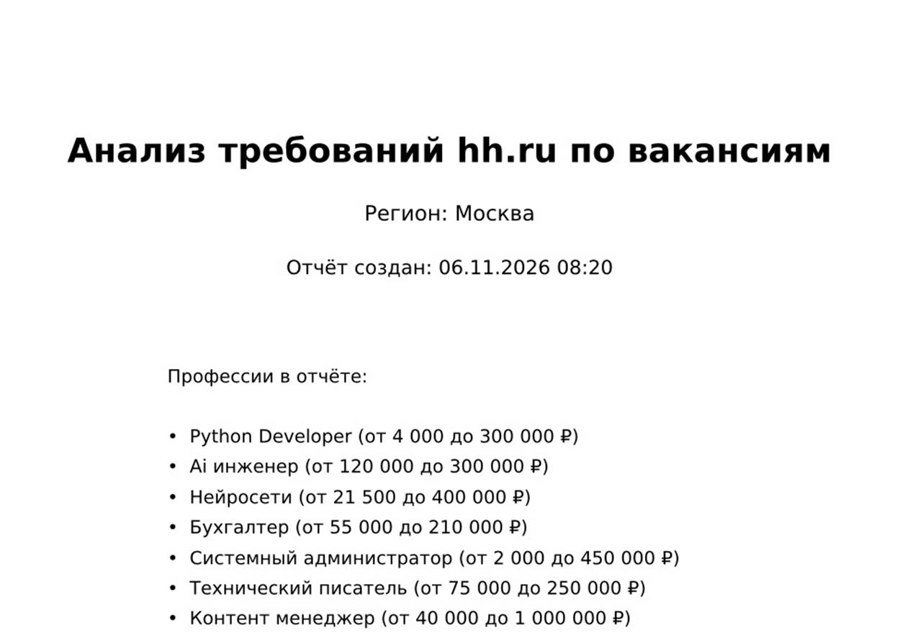
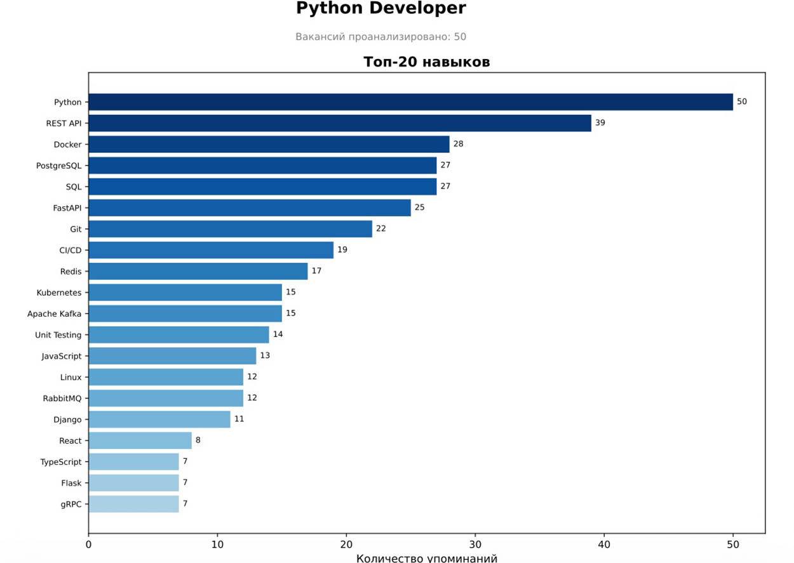
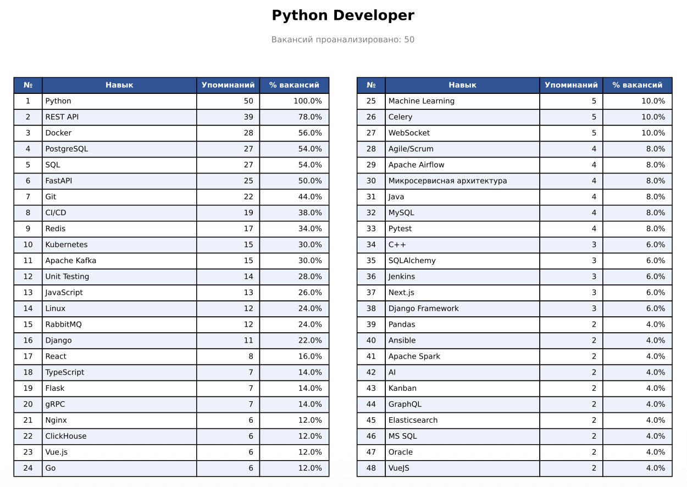
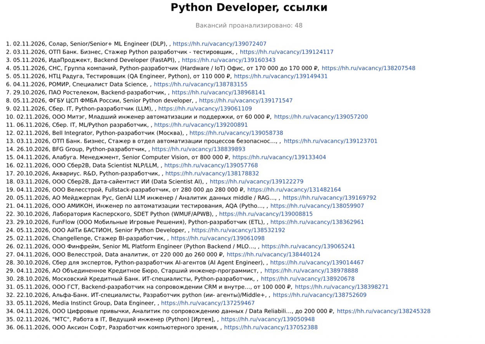

# 🕷️ HH Skills Parser

Система парсинга навыков и вакансий с сайта hh.ru на Python. Автоматически собирает вакансии через Selenium, извлекает ключевые навыки и формирует табличный отчёт с сортировкой по частоте упоминания.

Код написан с использованием LLM (Large Language Model)


English version: [README.md](README.md)

## 🖼️ Примеры страниц отчета

<div align="center">

&nbsp; &nbsp;

</div>
<div align="center">

&nbsp; &nbsp;

</div>

## 🏗️ Архитектура

### Компоненты системы

1. **config.py** — Конфигурация + словарь навыков
   - Словари из dictionary/ для извлечения навыков
   - Настройки парсера через dataclass
   - Загрузка/сохранение YAML

2. **hh_core.py** — Ядро (данные и сбор):
   - **Vacancy** — модель вакансии
   - **HHSeleniumScraper** — Парсер hh.ru через Selenium
   - **SkillExtractor** — NLP извлечение навыков
   - **Storage** — Хранилище данных (SQLAlchemy)
   - загрузка страниц вакансий и разбор организации/даты/зарплаты

3. **hh_reports.py** — Генераторы отчётов:
   - **ReportGenerator** — Excel, CSV, PNG-график
   - **PdfReportGenerator** — многостраничный PDF с кликабельными ссылками

4. **hh_pipeline.py** — Сценарии работы:
   - **run_parsing** — полный прогон парсинга
   - **recalc_skills** — пересчёт навыков по БД
   - **fill_employers** — дозаполнение организаций/дат
   - **report_only** / **build_sections_from_db** — отчёты из БД

5. **main.py** — CLI точка входа (аргументы, логирование, диспетчеризация режимов)

### Поток данных

```
Ввод профессий → Selenium парсер → Raw данные → Извлечение навыков →
vacancies.db → Генератор отчётов → reports/
```

### Структура проекта

```
python_project/
├── main.py                  # Точка входа (CLI, логирование)
├── hh_core.py               # Модель вакансии, Selenium-скрапер, извлечение навыков, хранилище
├── hh_reports.py            # Генераторы отчётов: Excel/CSV/PNG и PDF
├── hh_pipeline.py           # Сценарии: парсинг, пересчёт, дозаполнение, отчёты из БД
├── config.py                # Конфигурация парсера
├── dictionary/              # Словари навыков (.yaml) и конфиг сбора config.yaml
├── vacancies.db             # База данных SQLite (создаётся автоматически)
├── requirements.txt         # Зависимости Python
├── reports/                 # Выходные отчёты
│   ├── skills_report.xlsx   # Excel таблица
│   ├── skills_report.csv    # CSV таблица
│   ├── skills_chart.png     # График топ-20 навыков
│   └── YYYY-MM-DD-hh-parser.pdf  # PDF: титул (регион, вилки), по каждой профессии — график, таблица навыков и список вакансий (строкой через запятые, со ссылками)
├── log/                     # Логи: файл на месяц (2026-11-hh-parser.log)
├── tests/
│   └── test_all.py          # Объединённые тесты
├── README.md                # Английская версия
└── README_RU.md             # Этот файл (русская версия)
```

## 🚀 Быстрый старт

### 1. Установка зависимостей

```bash
pip install -r requirements.txt
```

### 2. Установка Chrome браузера

**Windows:** Скачайте с <https://www.google.com/chrome/>

**macOS:**

```bash
brew install --cask google-chrome
```

**Linux (Ubuntu/Debian):**

```bash
sudo apt-get install google-chrome-stable
```

### 3. Запуск парсера

```bash
python main.py
```

Без `--config` автоматически подхватывается `dictionary/config.yaml` —
конфиг со профессиями и словарями.

Или с параметрами:

```bash
python main.py -p "Python Developer" "Data Engineer" --pages 10
```

## 📋 Использование

### Параметры командной строки

```bash
# Указать профессии
python main.py -p "Python Developer" "Data Engineer" "Backend Developer"

# Указать регион (1=Москва, 2=Санкт-Петербург)
python main.py -a 2

# Указать количество страниц
python main.py --pages 10

# Комбинированная команда
python main.py -p "Go Developer" -a 1 --pages 15

# Быстрый прогон: меньше страниц и лимит деталей
python main.py -p "Python Developer" --pages 2 --max-details 40

# Пересчитать навыки по всей БД с новыми словарями (дополняет, не удаляет);
# skills_*.yaml — все 7 словарей разом, можно перечислить только нужные
python main.py --recalc-skills dictionary/skills_*.yaml

# Дозаполнить организацию и дату публикации по вакансиям, сохранённым в БД
python main.py --fill-employers

# Перегенерировать все отчёты (Excel/CSV/PNG + PDF) из БД без парсинга
# (в PDF войдут только профессии из конфига, в его порядке)
python main.py --report-only
```

### Профессии: включение, выключение и порядок в отчёте

**Где задаются.** Единственный источник списка профессий и словарей —
`dictionary/config.yaml` (ключи `professions` и `skills_files`); разово
переопределяется через `-p` / `--skills-file`. В `config.py` этих списков нет —
поля пустые по умолчанию, дублирования не возникает. (`config.py` хранит
значения по умолчанию остальных параметров: регион, задержки, пути.)

Что имеет приоритет:

```
--professions (-p)  →  --config <файл>  →  dictionary/config.yaml
```

Если профессии не заданы нигде (нет YAML и нет `-p`), парсинг и генерация
отчётов не запускаются — в лог пишется `⚠️ Профессии не заданы …`.

**Комментирование.** Ненужные профессии просто закомментируйте в `professions`:

```yaml
professions:
  - "Системный администратор"
  - "Бухгалтер"
  - "Ai инженер"
#  - "Нейросети"
#  - "Python Developer"
#  - "Технический писатель"
#  - "Контент менеджер"
```

Такие профессии **не парсятся** и **не попадают в отчёт**: в обычном запуске
разделы строятся только по профессиям из списка, а в `--report-only` профессии,
которые есть в БД, но отсутствуют в конфиге, пропускаются (в логе —
`⏭️ В БД есть профессии вне конфига — пропущены: …`). Вакансии при этом
остаются в БД: вернув профессию в список и запустив `--report-only`, вы
снова увидите её в отчёте без повторного парсинга. Строки в `skills_files`
для выключенной профессии можно не трогать — они не используются.

**Сортировка.** Профессии в отчёте идут **в том порядке, в котором записаны
в `professions`** в файле config.yaml — не по алфавиту и не по числу вакансий:

- обычный запуск — разделы в порядке списка (он же порядок парсинга);
- `--report-only` — перебор по списку, берутся только профессии, имеющиеся в БД;
- титульная страница — тот же порядок.

Внутри раздела профессии: навыки — по убыванию числа упоминаний, вакансии
на своей странице — в порядке выдачи hh.ru (нумерация — по порядку строк).
Чтобы поменять порядок разделов, переставьте строки в `professions`.

### Страницы по профессии в PDF

У каждой профессии три страницы; заголовок — «<профессия>, <тип>»:

1. «<профессия>, график» — топ-20 навыков (горизонтальная гистограмма);
2. «<профессия>, таблица» — таблица навыков (48 навыков в двух колонках
   с продолжением; шрифт таблицы 8 pt — как на графике);
3. «<профессия>, вакансии» — список вакансий (см. ниже).

Заголовок «Вакансий проанализировано: N» под каждой страницей профессии
выводится шрифтом 8 pt. Зарплата в заголовках не выводится — она указана
в строке каждой вакансии на странице ссылок.

### Страница вакансий в PDF

Страница «<профессия>, вакансии» — после графика и таблицы навыков идёт список
вакансий: **не более 50 последних вакансий**, одна вакансия — одна строка,
элементы через запятую (шрифт 8 pt — как на графике и в таблице) —

```
1. 30.10.2026, ООО Ромашка, Python Developer, от 80 000 до 150 000 ₽, https://hh.ru/vacancy/138976477
```

- ссылка полная (`https://hh.ru/vacancy/<id>`) и **кликабельная** (клик открывает вакансию), не укорачивается;
- организация берётся со страницы вакансии (`data-qa="vacancy-company-name"`), а если
  страницу не удалось загрузить — из карточки выдачи (`vacancy-serp__vacancy-employer`);
- название вакансии и название организации длиннее 50 символов — укорачиваются до 50 с «…»;
- после названия вакансии выводится её зарплата (`от X до Y ₽`, `от X ₽`, `до Y ₽`);
  если не указана — пустое место;
- не умещается в одну строку — перенос на вторую строку;
- не помещается на страницу — продолжение на следующей странице **без заголовка**, с той же нумерацией;
- дата — в формате `дд.мм.гггг`.

### Режим без парсинга (`parsing_hh`)

Параметр `parsing_hh` задаётся в `dictionary/config.yaml` (значение по умолчанию — в `config.py`):

- `true` (по умолчанию) — обычный режим: парсинг hh.ru через Selenium, отчёты по результатам запуска;
- `false` — без интернета: отчёты (Excel/CSV/PNG + PDF) строятся по **последним 50 вакансиям каждой профессии** из БД (по дате сохранения `parsed_at`, самые свежие первыми). Профессии берутся из `professions` конфига, в его порядке; вакансии остаются в БД.

```yaml
parsing_hh: false
```

CLI-флаги (`--fill-employers`, `--recalc-skills`, `--report-only`) работают независимо от `parsing_hh` и имеют приоритет над ним; `--report-only` без лимита строит отчёты по всем вакансиям БД.

### YAML конфигурация

Создайте файл `dictionary/config.yaml`:

```yaml
professions:
  # Профессии можно комментировать — из отчёта они тоже исключаются
  # (см. «Профессии: включение, выключение и порядок в отчёте» выше)
  - "Python Developer"
  - "Data Engineer"
  - "Backend Developer"
parsing_hh: true   # false — отчёт по последним 50 вакансиям каждой профессии из БД
area_id: 1
max_pages: 20
max_details_per_profession: 50
request_delay: 0.5
db_path: "vacancies.db"
reports_dir: "reports"
chart_top_n: 20
skills_file: "dictionary/skills_accounting.yaml"   # свой словарь навыков (опционально)
```

Запустите с конфигом:

```bash
python main.py --config dictionary/config.yaml
```

## ⏱️ Длительность работы

Парсер работает через браузер, поэтому основное время — не вычисления, а **ожидание сети**: загрузка страниц в Chrome и намеренные паузы между запросами (антибан). CPU при этом почти не нагружен (~0%).

### Ориентиры (после оптимизации: eager + блокировка картинок)

| Этап | Время | Из чего складывается |
| --- | --- | --- |
| Старт Chrome + первая страница поиска | ~10 c | запуск WebDriver (~2.5 c) + загрузка выдачи |
| Страница поиска | ~4–6 c | загрузка (eager, без картинок) + пауза 1.5 c |
| Страница вакансии (детали) | ~4–5 c | загрузка страницы (2.5–8 c, зависит от hh.ru) + вежливая пауза 0.5–1 c |

Узкое место — **загрузка самой страницы hh.ru** (сервер + JS): это не регулируется настройками парсера. Прикидка:

```
время ≈ число вакансий с деталями × ~5 c  +  число страниц поиска × ~5 c
```

### Примеры

| Сценарий | Запуск | Время |
| --- | --- | --- |
| Быстрый тест | `--pages 1 --max-details 10` | ~1–2 мин |
| Одна профессия, 2 страницы, 50 деталей | `--pages 2 --max-details 50` | ~4–5 мин |
| Три профессии, 2 страницы | `-p "A" "B" "C" --pages 2` | ~10–12 мин |
| Три профессии, `max_pages: 20`, без лимита | `python main.py` | ~3 часа и более |

Дубликаты между профессиями не обрабатываются повторно, поэтому пересекающиеся запросы идут быстрее, чем первый.

### Если нужно быстрее

- `--max-details N` — главный регулятор длительности (детали — узкое место);
- меньше профессий и/или `--pages`;
- ограничить `request_delay` вниз — **не рекомендуется** (< ~0.3 c растёт риск капчи/бана), как и параллельные запуски.

Цифры ориентировочные: зависят от канала и нагрузки hh.ru.

## 🧠 Словарь навыков

Система извлекает навыки по YAML-словарям из папки `dictionary/` — для каждой профессии свой файл. Словарь для «Python Developer» (`skills_python_dev.yaml`) содержит 78 ключей (67 канонических навыков) в 9 категориях:

- 💻 Языки программирования (Python, JavaScript, Go, Rust и др.)
- 🗄️ Базы данных (PostgreSQL, MongoDB, Redis и др.)
- 🎨 Фреймворки (Django, React, Spring и др.)
- 🐳 DevOps (Docker, Kubernetes, CI/CD и др.)
- 🔌 API (REST, GraphQL, gRPC)
- 📨 Очереди (Kafka, RabbitMQ)
- 🤖 ML/Data (TensorFlow, PyTorch, Pandas)
- 📋 Методологии (Agile, Scrum)
- 📦 Прочее

### Как словарь применяется по профессии

Для каждой профессии из запуска выбирается **один** словарь по цепочке приоритета:

```
skills_files[профессия]  →  skills_file  →  без словаря (только «Ключевые навыки»)
```

Дальше навыки извлекаются из двух источников:

1. **Блок «Ключевые навыки»** на карточке вакансии (готовые теги hh.ru) — каждый тег
   нормализуется через словарь: известный ключ заменяется каноническим именем
   (`postgres` → `PostgreSQL`), неизвестный попадает в отчёт **как есть**.
2. **Описание вакансии** — текст очищается от HTML и приводится к нижнему регистру,
   затем ищутся ключи словаря по границам слов (`\bgo\b` не сработает внутри «going»);
   найденное заменяется каноническим именем.

Навык учитывается **один раз на вакансию** — даже если упомянут и в тегах, и в описании,
и несколько раз в тексте. «% вакансий» в отчёте — доля вакансий, где навык встретился.

### Если важного навыка нет в словаре

| Где упомянут навык на hh.ru | Попадёт в анализ? |
| --- | --- |
| В блоке «Ключевые навыки» вакансии | **Да** — пройдёт «как есть», даже без словаря |
| Только в тексте описания | **Нет** — из описаний извлекаются только ключи словаря |

Пример блока «Ключевые навыки» вакансии на hh.ru
<div align="center">

</div>

Что делать: добавить ключ в словарь (одна строка) и пересчитать историю —

```bash
python main.py --recalc-skills dictionary/skills_*.yaml
```

Описания хранятся в БД, поэтому пересчёт применит новые ключи ко всем прошлым прогонам:
дополнит и уточнит статистику, ничего не удалив. Пока ключ не добавлен, ориентир —
«хвост» CSV: незнакомые словарю навыки всё равно видны там через ключевые навыки.

**Добавление новых навыков:**

```python
# dictionary/skills_python_dev.yaml — в нужную категорию
  "new_skill": "New Skill Name"
```

**Свой домен (например, «Бухгалтер»):** положите словарь в YAML и подключите:

```yaml
# dictionary/skills_accounting.yaml — плоский словарь или с категориями
Учётные системы:
  "1с": "1С"
  "1с:зуп": "1С"
Инструменты:
  "excel": "Excel"
```

Заголовки категорий (`Учётные системы:`, `Инструменты:`) — только комментарии для
чтения, на логику извлечения не влияют: словарь «схлопывается» в плоский набор
`ключ → канон`. Словарь может быть и вовсе плоским, без категорий.

```bash
python main.py -p "Бухгалтер" --skills-file dictionary/skills_accounting.yaml
```

Свой словарь на каждую профессию — через `skills_files` в config.yaml. Схема проекта:
одна профессия — один выделенный словарь, без общей базы:

```yaml
skills_files:
  "Python Developer": "dictionary/skills_python_dev.yaml"
  "Бухгалтер": "dictionary/skills_accounting.yaml"
  "Нейросети": "dictionary/skills_neural.yaml"
  "Ai инженер": "dictionary/skills_ai_engineer.yaml"
  "Системный администратор": "dictionary/skills_sysadmin.yaml"
  "Технический писатель": "dictionary/skills_techwriter.yaml"
  "Контент менеджер": "dictionary/skills_content_manager.yaml"
```

Приоритет: `skills_files[профессия]` > `skills_file` > без словаря.

Если профессии нет в `skills_files`, словаря у неё не будет — навыки извлекутся
только из блока «Ключевые навыки». Маппьте каждую профессию. Код принимает и
список файлов (значения сольются в один словарь), но текущая схема использует
один файл на профессию.

### Советы по развитию словаря

1. **Начинайте с пробного прогона** и «хвоста» CSV: частые навыки, пришедшие «как есть»
   из ключевых, — первые кандидаты в словарь (так собран `dictionary/skills_accounting.yaml`).
2. **Схлопывайте синонимы**: все варианты (`golang`/`go`, `1С: Бухгалтерия`/`1C: Бухгалтерия`)
   должны давать один канон — иначе статистика дробится на бессмысленные строки.
3. **Не создавайте ключ-подстроку с другим каноном**: если `1с: бухгалтерия` →
   `1С:Бухгалтерия`, то ключ `1с` должен вести в `1С:Бухгалтерия` или в родительский
   канон `1С` — иначе вакансия засчитает навык дважды.
4. **Для русских фраз добавляйте ё/е-варианты и частотные падежи**
   (`расчет зарплаты`/`расчёт заработной платы`, `с банк-клиентом`).
5. **Аббревиатуры** (`МСФО`, `ЭДО`, `RAG`) не склоняются — хватает одной формы;
   обычные слова склоняются — добавляйте формы.
6. **Не добавляйте слишком общие слова** («опыт», «ответственность», «отчётность» без
   уточнения) — соберут всё подряд и обезличат топ.
7. **Короткие ключи** (`go`, `r`, `1с`) защищены границами слов, но после добавления
   проверьте пару отчётов на ложные срабатывания.
8. **Держите один YAML на домен** и подключайте через `skills_files` — один прогон
   считает разные профессии, каждая со своим словарём.
9. **После пополнения — `--recalc-skills`**: история в БД пересчитается без повторного
   парсинга.

## 🗄️ База данных

SQLite, файл `vacancies.db` (путь настраивается в `config.db_path`), создаётся автоматически при запуске. Схема описана SQLAlchemy в `hh_core.py`, три таблицы:

### Таблица `vacancies` — вакансии

| Столбец | Тип | Описание |
| --- | --- | --- |
| `id` | String, PK | ID вакансии с hh.ru (число из URL `/vacancy/<id>`) |
| `name` | String, NOT NULL | Название вакансии |
| `description` | Text | Текст описания со страницы вакансии (без HTML-тегов) |
| `employer` | String | Работодатель (название компании со страницы вакансии) |
| `area` | String | Регион (сейчас не заполняется — зарезервировано) |
| `url` | String | Ссылка на страницу вакансии |
| `salary_min` | Integer | Минимальная зарплата из карточки (если указана) |
| `salary_max` | Integer | Максимальная зарплата |
| `profession` | String | Профессия поиска, по которой найдена вакансия |
| `published_at` | String | Дата публикации (текст с hh.ru, например «30 октября 2026») |
| `parsed_at` | DateTime | Момент сохранения (UTC) |

### Таблица `skills` — канонические навыки

| Столбец | Тип | Описание |
| --- | --- | --- |
| `id` | Integer, PK | Автоинкремент |
| `name` | String, UNIQUE | Каноническое название навыка («Python», «REST API», …) из словаря профессии |

### Таблица `vacancy_skill` — связь many-to-many

| Столбец | Описание |
| --- | --- |
| `vacancy_id` | FK → `vacancies.id` |
| `skill_id` | FK → `skills.id` |

Одна строка — один уникальный навык одной вакансии.

### Что важно знать

- **Дедупликация**: `id` — первичный ключ, повторная вставка вакансии пропускается. БД накапливает данные между запусками — каждый прогон добавляет только новые вакансии.
- **Отчёты**: Excel/CSV/PNG строятся по всей накопленной БД (все запуски); PDF-разделы — только по профессиям из конфига (в обычном запуске — текущего, в `--report-only` — профессиям из БД в порядке конфига; профессии БД вне конфига пропускаются). При `parsing_hh: false` все отчёты строятся по последним 50 вакансиям каждой профессии (см. «Режим без парсинга»).
- **Пересчёт навыков**: `python main.py --recalc-skills [словари.yaml]` — заново извлекает навыки из сохранённых описаний с текущими словарями и обновляет связи. Дополняет и уточняет; ничего не удаляет. Excel/CSV/PNG обновляются автоматически.
- **Организация вакансии**: сохраняется при парсинге (карточка выдачи + страница вакансии). Для записей, созданных до появления поля, — `python main.py --fill-employers`: страницы вакансий загружаются прямыми HTTP-запросами и поля `employer`/`published_at` дозаполняются. После этого отчёты можно перегенерировать без нового парсинга — `python main.py --report-only`.
- **Зарплатные вилки**: зарплаты и профессия хранятся в БД; дубликаты дополняются зарплатой при повторной загрузке. Схема обновляется автоматически (миграция добавляет столбцы).
- **Сброс**: удалите `vacancies.db` — при следующем запуске будет создана пустая.
- **Резервная копия**: достаточно скопировать файл (SQLite — одиночный файл).
- **Просмотр**: `sqlite3 vacancies.db "SELECT s.name, COUNT(*) FROM skills s JOIN vacancy_skill vs ON s.id=vs.skill_id GROUP BY s.name ORDER BY 2 DESC;"` или DB Browser for SQLite.

## 🔑 Ключевые особенности

- **Selenium парсинг** — обход детекции автоматизации, работа без авторизации
- **NLP извлечение** — регулярные выражения + словарь навыков
- **Нормализация** — синонимы → канонические названия
- **Множественные форматы** — Excel, CSV, PNG график, PDF-отчёт по профессиям (кириллица)
- **Расширяемость** — легко добавить новые навыки в словарь

## 🧪 Тестирование

```bash
# Запуск всех тестов
pytest tests/test_all.py -v

# Запуск с покрытием
pytest tests/test_all.py --cov=. --cov-report=term-missing
```

## 📝 Требования

- Python 3.11+
- Chrome/Chromium браузер
- Интернет-соединение

## ⚠️ Важно

- Соблюдайте условия использования hh.ru
- Не превышайте разумные лимиты запросов
- Selenium работает медленнее API, но не требует авторизации
- При публикации на GitHub все комментарии и тексты должны быть на английском языке, если это отдельно не указано; исключение — файлы с `_RU` в названии

## 📄 Лицензия

MIT License

---

**Примечание:** Проект использует Selenium для парсинга hh.ru без авторизации. API hh.ru закрыт с апреля 2026 года и требует OAuth токен.
